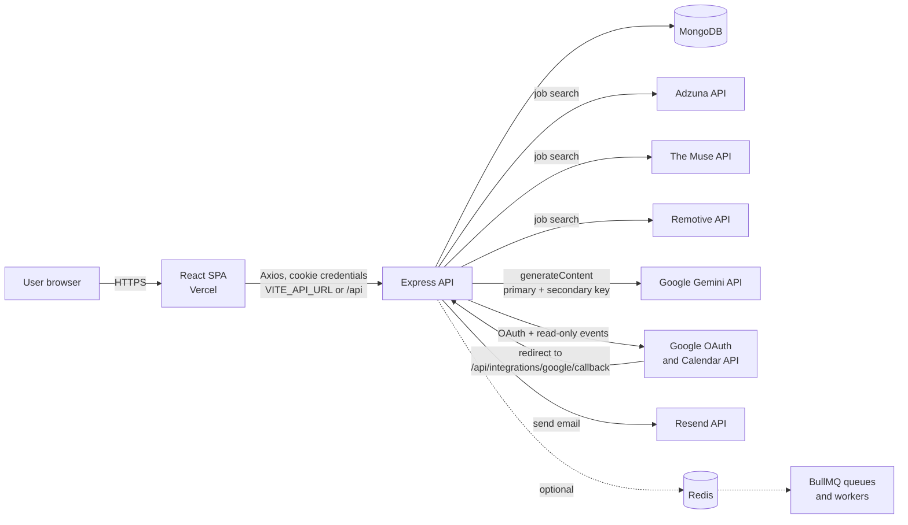
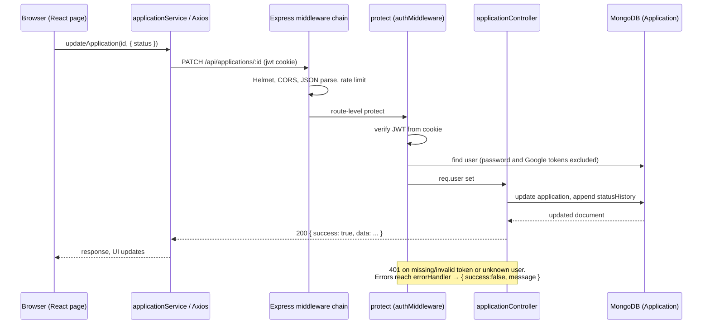
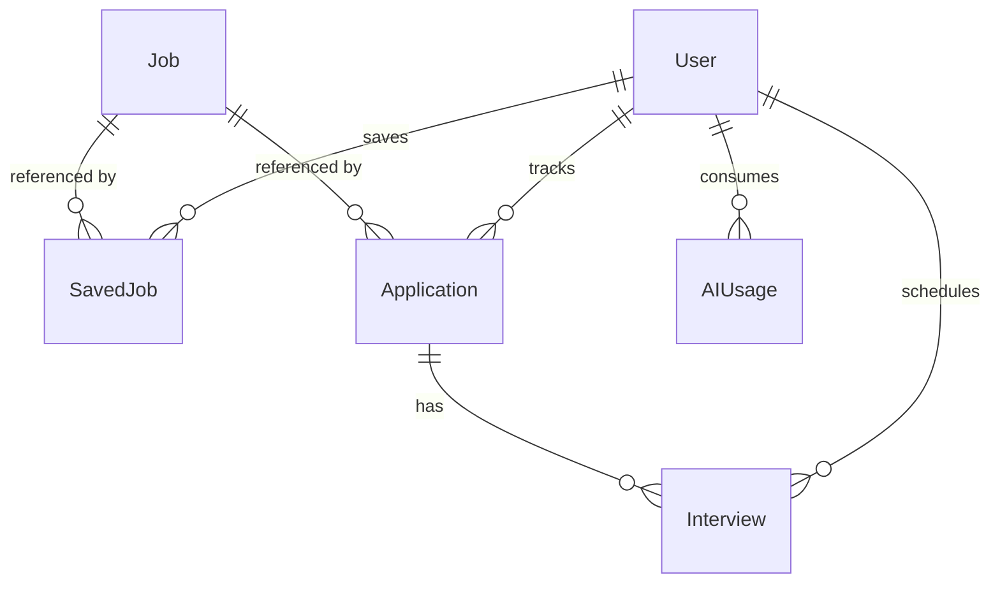
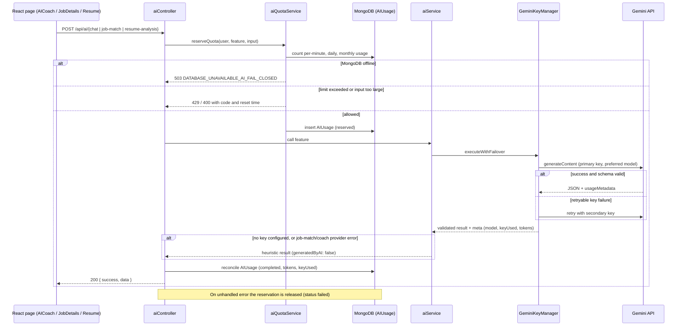
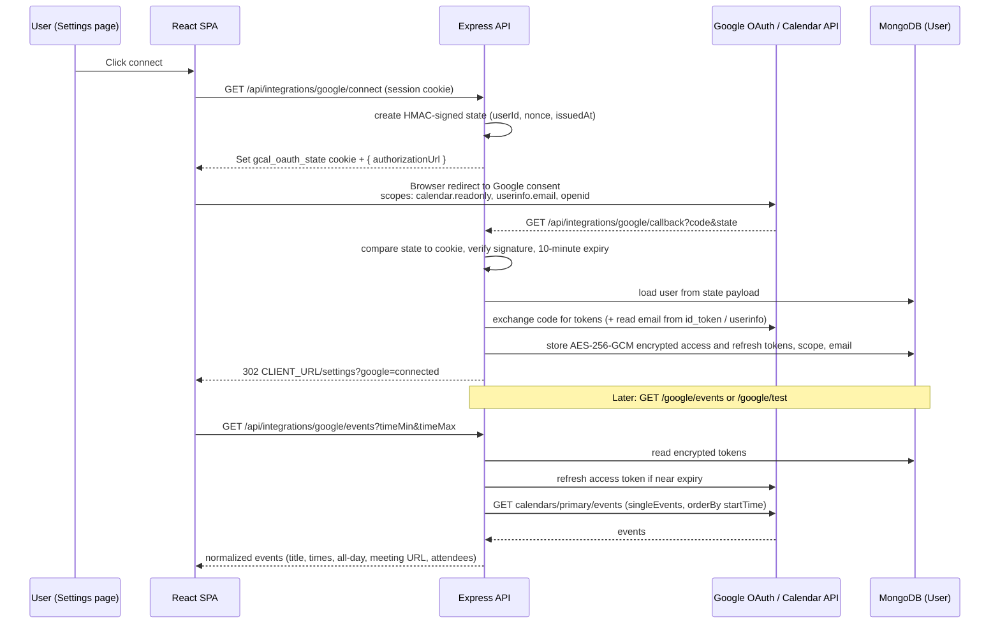
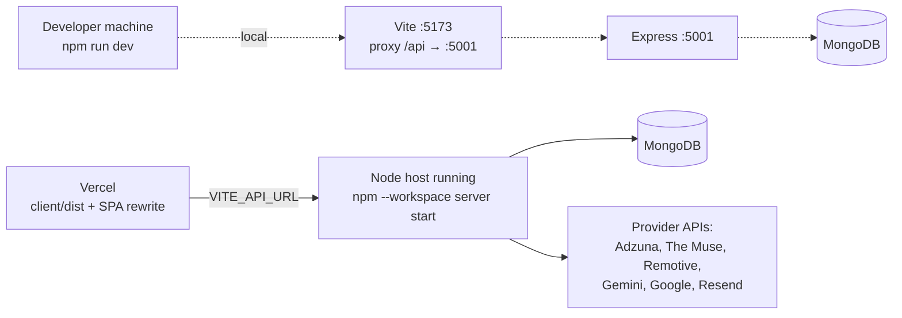

# CareerPilot Architecture

Live application: https://careerpilot-self-ten.vercel.app/
Repository: https://github.com/ANTARIKSH2007TAMULY/CAREERPILOT

This document describes the system as implemented in the source code. See [`README.md`](README.md) for setup and [`IMPLEMENTATION_STATUS.md`](IMPLEMENTATION_STATUS.md) for per-feature status.

---

## 1. System overview

CareerPilot is an npm-workspaces monorepo with two deployable units:

- **`client`**: a React single-page application built with Vite. The production build is served from Vercel at the live URL.
- **`server`**: an Express API (ES modules) backed by MongoDB. It aggregates jobs from external providers, calls Google Gemini for AI features, performs the Google Calendar OAuth flow, and sends email through Resend.

Redis and BullMQ are optional add-ons. The API starts and serves all core features without them.



Dashed lines are optional. If `REDIS_URL` is unset or unreachable, the API runs with no Redis, no queues, and no workers.

---

## 2. Frontend architecture

**Stack:** React 18, React Router 6, Axios, Tailwind CSS, Recharts, Framer Motion, Lucide icons.

**Bootstrapping.** `main.jsx` mounts `App` inside the theme and auth providers. `AuthContext` calls `GET /api/auth/me` on load to restore the session from the cookie; `ThemeContext` persists light/dark/system in `localStorage` (`careerpilot-theme`).

**API client.** `services/api.js` creates one Axios instance with `baseURL = VITE_API_URL || '/api'` and `withCredentials: true`. A response interceptor converts failures into `Error(message)` using the server's `message` field. Domain wrappers exist in `authService`, `jobService`, `applicationService`, `interviewService`, `aiService`, and `calendarService`. Some pages (Profile, Resume, Settings, Saved Jobs) call `api` directly.

**Routes** (`App.jsx`):

| Path | Page | Access |
|---|---|---|
| `/` | Landing | Public |
| `/login`, `/register` | Login, Register | Public |
| `/dashboard` | Dashboard (stats, trend chart, recent applications, deadlines/interviews, featured jobs) | Protected |
| `/jobs` | Discover Jobs (search, filters, sort, pagination) | Protected |
| `/jobs/:id` | Job details (save, track/status, AI match, external apply) | Protected |
| `/saved-jobs` | Saved Roles | Protected |
| `/applications` | Application Tracker (Kanban board / list, interview modal) | Protected |
| `/resume` | Resume & Fit (resume text, AI resume analysis) | Protected |
| `/analytics` | Pipeline Analytics (4 charts, 4 conversion metrics) | Protected |
| `/ai-coach` | AI Career Coach (chat, usage display) | Protected |
| `/profile` | Candidate Profile | Protected |
| `/settings` | Settings & Integrations (password, notifications, Google Calendar) | Protected |

Protected routes render inside `AppShell` (sidebar + content) via a `ProtectedRoute` wrapper that redirects unauthenticated users to `/login`. `client/vercel.json` rewrites every path to `/index.html` so deep links work.

`pages/Calendar.jsx` (a full month/agenda view backed by `calendarService`) exists but is not imported by `App.jsx` and has no sidebar entry, so it is not reachable in the running UI.

---

## 3. Backend architecture

**Entry point** (`server/index.js`) applies, in order: Helmet, CORS (`origin = CLIENT_URL`, credentials on), JSON parser (1 MB), cookie parser, global rate limiter (200 requests / 15 minutes), routes, `notFound`, `errorHandler`. `trust proxy` is set to 1.

**Startup sequence:** validate environment → `connectDB()` → `connectRedis()` → `startWorkers()` → `reconcilePendingReminders()` → listen on `0.0.0.0:PORT`. MongoDB, Redis, and the workers each fail soft (see §9 and §10); only an invalid required configuration in production aborts startup.

**API organization** (all under `/api`):

| Prefix | Auth | Endpoints |
|---|---|---|
| `/health` | none | `GET /` liveness; `GET /ready` readiness (Mongo, Redis, provider configuration) |
| `/auth` | mixed | `POST /register`, `POST /login`, `POST /logout`, `GET /me`, `PUT /password` |
| `/user` | yes | `GET /profile`, `PUT /profile` |
| `/jobs` | none | `GET /` (search), `GET /ingestion-status`, `GET /:id` |
| `/saved-jobs` | yes | `GET /`, `POST /:jobId`, `DELETE /:jobId` |
| `/applications` | yes | CRUD (`GET /`, `POST /`, `GET/PATCH/DELETE /:id`), `POST/GET /:applicationId/interviews` |
| `/interviews` | yes | `GET /upcoming`, `GET/PATCH/DELETE /:id`, `POST /:id/test-email`, `PATCH /:id/reminders` |
| `/analytics` | yes | `GET /summary`, `GET /trends?range=7d\|30d\|90d\|6m` |
| `/ai` | yes | `GET /usage`; `POST /job-match`, `/chat`, `/resume-analysis`, `/roadmap`, `/interview-prep` |
| `/integrations/google` | mixed | `GET /status`, `GET /connect`, `GET /callback` (public), `GET /events`, `POST /disconnect`, `GET /test` |

Job search (`GET /api/jobs`) is public: it does not require a session.

Controllers are thin and wrapped in `asyncHandler`; business logic lives in `services/`. Each stateful controller checks `isMongoConnected()` and otherwise uses the in-memory demo stores in `config/demo*.js`.

---

## 4. Request and response flow

A typical authenticated request, using "update an application's status" as the example:



Response envelope: `{ success: true, data: ... }` on success and `{ success: false, message }` on error (AI quota errors use `{ success:false, error:{ code, message, ... } }`). Job and saved-job list responses additionally mirror `jobs` at the top level for client compatibility.

---

## 5. Authentication and authorization

- **Register/login** validate input, hash with bcrypt (cost 12), and issue a JWT (`{ id }`, 7-day expiry) in an HTTP-only cookie named `jwt`. The cookie is `secure` + `SameSite=None` when `NODE_ENV=production` and `SameSite=Lax` otherwise.
- **`protect` middleware** reads the cookie, verifies the token with `JWT_SECRET`, loads the user (excluding the password hash and encrypted Google tokens), and attaches it as `req.user`. All user-specific routes use it.
- **Authorization** is ownership-based: controllers filter every query by `user: req.user._id`. There are no roles.
- **Logout** clears the cookie. **Password change** requires the current password.
- **Secrets:** in production the server will not start unless `JWT_SECRET` is set to a non-default value. In other environments it falls back to a development default.

---

## 6. Database models

MongoDB via Mongoose. Collections and relationships:



| Model | Purpose and key fields |
|---|---|
| `User` | `name`, unique lowercase `email`, bcrypt `password`, `skills`, `education[]`, `experience[]`, preferred roles/locations/job types/work modes, `resume` text, `socialLinks`, `notificationPreferences` (`jobAlerts`, `applicationReminders`, `interviewReminders`, `unsubscribedAt`), and `googleCalendar` (`connected`, `connectedEmail`, `encryptedAccessToken`, `encryptedRefreshToken`, `expiryDate`, `scope`, `connectedAt`) |
| `Job` | Normalized listing: title, company, description, location, `jobType` (Full-time/Internship/Contract/Part-time), `workMode` (Remote/Hybrid/On-site/Unspecified), `experienceLevel`, `skills`, `salary`, `source`, `providerJobId`, `sourceUrl`, `applyUrl`, `postedAt`, `isActive`. Unique index on `(source, providerJobId)`; text index on title/company/description |
| `SavedJob` | `user`, optional `job` ref, and a `jobSnapshot` copy of the listing so saved items survive catalog changes. Unique per `(user, job)` |
| `Application` | `user`, optional `job` ref plus denormalized title/company/location/salary/applyUrl/source, `status` (9 values), `appliedAt`, `deadline`, `interviewDate`, `interviews[]`, offer fields, notes, `nextAction`, `recruiter`, `statusHistory[]`. Indexed by user/status/date |
| `Interview` | `user`, `application`, type (Phone/Video/Technical/HR/On-site/Other), `startTime`, `endTime`, `timezone`, `meetingUrl`, `location`, `interviewer`, `notes`, `status`, `reminderPreferences` (`3d`,`1d`,`6h`,`1h`), `reminders[]` (due time, status, attempts, Resend id), reschedule links |
| `AIUsage` | One record per AI request: feature, status (`reserved`/`completed`/`failed`/`rejected`), model, `keyUsed`, token counts, and day/month/minute keys. 90-day TTL index |
| `AIAnalysis` | Defined but not referenced by any controller or service |

---

## 7. Job search aggregation and normalization

```text
GET /api/jobs?keyword&location&jobType&workMode&experienceLevel&skills&source&sort&page&limit
        │
        ▼
searchAggregatedJobs()   ── 15-min in-process cache + in-flight de-duplication per query
        │   parallel, one adapter per selected provider
        ├── Adzuna   (needs app id + key; skipped as "Not configured" otherwise)
        ├── The Muse (public API; key optional)
        └── Remotive (public API)
        ▼
normalize (per adapter → jobSchema): job type, work mode, experience level, salary, skills, HTML stripped
        ▼
dedupeJobs()  ── identity (source:providerJobId, else URL) + company::title::location fallback
        ▼
filterJobsByLast30Days()
        ▼
persistJobs()  ── bulk upsert into MongoDB (skipped when Mongo is down)
        ▼
getJobs() reads the filtered, sorted, paginated result
        ├─ MongoDB connected: query the Job collection (regex filters, sort, skip/limit; limit ≤ 50)
        └─ MongoDB offline:   filter/sort/paginate the aggregated in-memory list
```

After responding to a search, `scheduleCatalogBackfill()` runs once per process in the background: it pages through The Muse (up to `MUSE_MAX_PAGES`, stopping at the API's limit or on rate limiting) and runs 14 Adzuna keyword searches to widen the stored catalog. Progress is tracked in the in-memory `ingestionManager` and exposed at `GET /api/jobs/ingestion-status` and in the `providers` field of search responses. Backfill uses plain async code; it does not use BullMQ. Provider failures are isolated: a failing provider is reported in `providers[]` and the others still return results. `GET /api/jobs/:id` resolves by Mongo id, `source:providerJobId`, or URL.

---

## 8. AI / Gemini architecture

**Features:** job match, resume analysis, coach chat, career roadmap, interview prep. The UI uses the first three; all five have API endpoints.

**Components:**
- `aiController` — validates input, wraps each call in a quota lifecycle (reserve → execute → reconcile or release).
- `aiQuotaService` — enforces per-user limits using the `AIUsage` collection.
- `aiService` — picks the provider (only Gemini exists) and supplies heuristic fallbacks.
- `GeminiProvider` — builds prompts, calls the REST API, validates JSON against schemas in `aiSchemas`.
- `GeminiKeyManager` — holds the primary and secondary key state and performs failover.

**Two-key behavior (as implemented).** `GEMINI_API_KEY` becomes key `primary`; `GEMINI_API_KEY_2` becomes key `secondary` (ignored if empty or identical to the primary). `executeWithFailover` tries keys in order; there is no load balancing. Failure handling:

| Failure | Key state | Failover to other key |
|---|---|---|
| 401 / 403 / "API key not valid" / `PERMISSION_DENIED` | `invalid` (permanent for this process) | Yes |
| 429 / quota / `RESOURCE_EXHAUSTED` | `cooldown` 60 s | Yes |
| 5xx / timeout / reset (2 consecutive failures) | `cooldown` 30 s | Yes |
| 400 (non-key) or unrecognized error | unchanged | No; error is raised |

A short jitter (100–300 ms) precedes the retry on the second key. If all keys fail, the manager raises `All configured Gemini API keys failed`. Key state is held in memory per server process. Cooldown expiry is only evaluated by `getActiveKeyInfo`, which the request path does not call, so a key on cooldown stays deprioritized until the other key has been tried or the key succeeds.

**Model selection.** Inside each key attempt, models are tried in order: `GEMINI_MODEL` (default `gemini-3.5-flash-lite`), `gemini-3.5-flash-lite`, `gemini-3.5-flash`, `gemini-flash-latest` (de-duplicated). A schema-validation miss moves to the next model; 429/503 and auth errors are rethrown to the key manager. Generation uses temperature 0.2, `responseMimeType: application/json`, and `AI_MAX_OUTPUT_TOKENS`.



Fallback detail: job match and coach catch provider errors and return the heuristic result. Resume analysis, roadmap, and interview prep return the heuristic result only when no provider is configured or the provider returns nothing valid; a hard API failure on all keys surfaces as an error. Heuristic results are reconciled with zero tokens so they do not consume quota.

Quota defaults: 5 requests/minute, 20/day, 300/month, 50,000 tokens/day, 500,000 tokens/month, 6,000-token input cap, 2,000-token output cap. Windows are computed in UTC. `GET /api/ai/usage` returns the user's current usage summary, which the AI Coach page displays.

---

## 9. Google Calendar OAuth and data flow



Details:
- The callback route is public because the browser arrives from Google; identity comes from the signed `state` value that must also match the HTTP-only `gcal_oauth_state` cookie. Failures redirect to `/settings?google=denied|invalid-state|db-required|unauthorized|error`.
- Tokens are stored only if MongoDB is connected. Responses and the `protect` middleware exclude the encrypted token fields.
- On `invalid_grant`, a 401 from Google, or a missing refresh token, the user record is marked `connected: false` and the API returns `requiresReconnect: true`.
- **Capabilities:** connect, disconnect (revokes the token at Google and clears stored data), status, connection test (lists up to 5 calendars), and read events from the `primary` calendar (≤ 180-day window, ≤ 250 results, up to 4 pages fetched per call).
- **Not implemented:** event creation, modification, deletion, and automatic sync of CareerPilot interviews to Google Calendar. The requested scope is read-only.
- The Settings page hosts connect/disconnect/test. The events view (`Calendar.jsx`) is not routed.

---

## 10. Redis, queues, workers, and degraded mode

| Component | With Redis | Without Redis (current runtime) |
|---|---|---|
| Connection | `connectRedis()` connects with a 1.5 s timeout, no reconnect strategy | If `REDIS_URL` is empty or connect fails: log `Redis unavailable. Continuing without cache.` and continue |
| `cacheService` | get/set/del with 5-minute default TTL; also stores email idempotency markers (24 h) | Every call is a no-op returning `null`/`false`. An in-process `Set` still prevents duplicate sends within one process |
| Queues | `jobSyncQueue`, `aiQueue`, `notificationQueue` (3 attempts, exponential backoff) | `createQueue` returns `null`; no queue objects exist |
| Workers | Started for all three queues (concurrency 2) | Skipped: `BullMQ workers skipped because Redis is unavailable.` |
| Interview reminders | `scheduleRemindersForInterview` adds delayed `interview-reminder` jobs; the worker sends the email via Resend; startup `reconcilePendingReminders` re-queues pending reminders | Reminders are saved as `SCHEDULED` but no delivery mechanism runs. `reconcilePendingReminders` logs that it is deferred. Manual `POST /api/interviews/:id/test-email` still sends |
| Job aggregation cache | n/a (not Redis-based) | Uses the in-process 15-minute query cache either way |
| Health | `GET /api/health/ready` → `redis.operational: true` | `redis.operational: false`; endpoint still returns 200 |

Only interview reminders are ever enqueued by application code. `jobSyncQueue` and `aiQueue` have workers but no producer, and the job-alert and application-reminder email builders are reachable only through `notificationQueue` jobs that nothing enqueues. The deployed application is not documented as running Redis.

---

## 11. Email and notifications

`services/email/resendService.js` builds and sends email through the Resend REST API.
- `sendEmail` refuses to send unless called with `allowSend: true`, requires `RESEND_API_KEY`, and applies an idempotency key (in-process set, Redis marker when available, and Resend's `Idempotency-Key` header).
- `canSendEmail` honors user preferences (`jobAlerts`, `applicationReminders`, `interviewReminders`, `unsubscribedAt`), which users edit in Settings.
- Templates exist for interview reminders (3d/1d/6h/1h), job alerts, and application deadline reminders.
- `EMAIL_FROM` defaults in `.env.example` to Resend's shared test sender, which only delivers to the Resend account owner; sending to arbitrary recipients requires a verified Resend domain.
- Triggers actually wired: interview reminders via the BullMQ notification queue (Redis required) and the manual interview test email. There is no in-app inbox.

---

## 12. Error handling and security controls

| Concern | Implementation |
|---|---|
| Unknown routes | `notFound` → 404 `{ success:false, message }` |
| Unhandled errors | `errorHandler` → status from `err.statusCode`, otherwise 500; message hidden in production |
| Async errors | `asyncHandler` forwards rejections to `errorHandler` |
| Rate limiting | Global 200 req / 15 min per client; AI per-minute/day/month quotas per user |
| Headers / CORS | Helmet; CORS limited to `CLIENT_URL` with credentials |
| Input limits | 1 MB JSON body; AI input capped at `AI_MAX_REQUEST_TOKENS × 4` characters; calendar range ≤ 180 days; job page size ≤ 50 |
| Query safety | User-supplied filter text is regex-escaped before use in MongoDB queries |
| Secret handling | `redactSecrets`/`safeErrorMessage` mask API keys and bearer tokens in provider errors and logs; Google tokens encrypted with AES-256-GCM (key derived from `JWT_SECRET`); `.env` is git-ignored |
| Outbound HTTP | Shared `requestJson` helper with timeouts (15 s default), JSON parsing, and retryable-status classification |
| Provider failures | Per-provider isolation in aggregation; heuristic fallbacks for AI; reconnect signalling for Calendar |

---

## 13. Environment configuration

Defined in `.env.example` and read through `server/config/env.js` (which loads `.env` from the working directory, the repo root, and `server/`).

- **Required in production:** `JWT_SECRET` (non-default) and `MONGODB_URI`.
- **Optional integrations:** `REDIS_URL`; `GEMINI_API_KEY`, `GEMINI_API_KEY_2`, `GEMINI_MODEL`; `ADZUNA_*`; `THEMUSE_API_KEY`, `MUSE_*`; `RESEND_API_KEY`, `EMAIL_FROM`; `GOOGLE_CLIENT_ID`, `GOOGLE_CLIENT_SECRET`, `GOOGLE_REDIRECT_URI`, `GOOGLE_PROJECT_ID`.
- **Tuning:** `AI_*` limits, `ADZUNA_MAX_PAGES`, `MUSE_MAX_PAGES`, `MUSE_PRIMARY_PAGES`.
- **Behavior notes:** `AI_PROVIDER` is read from the file but the loaded configuration pins the provider to Gemini. `AI_USAGE_TIMEZONE` is parsed but quota windows are computed in UTC. `GOOGLE_PROJECT_ID` is not used by the OAuth code.
- **Client (build time):** `VITE_API_URL`.

At startup the server logs which optional integrations are configured; it never logs their values.

---

## 14. Deployment architecture



- **Frontend:** built with `npm run build` and served by Vercel at https://careerpilot-self-ten.vercel.app/. `vercel.json` provides the SPA rewrite.
- **Backend:** a single stateless Node process. The repository does not specify the backend host or URL; it must be reachable from the browser at the value given to `VITE_API_URL`, with `CLIENT_URL` set to the Vercel origin and `NODE_ENV=production` so session and OAuth-state cookies are `secure` and `SameSite=None` for cross-site use.
- **State** lives in MongoDB. In-process state (query cache, ingestion status, Gemini key state, demo-mode stores) is per instance and resets on restart.
- **Docker Compose** defines MongoDB 7 and Redis 7 for local development only; no Dockerfile packages the application.
- **Google Cloud:** `GOOGLE_REDIRECT_URI` must equal the backend's `/api/integrations/google/callback` URL and be registered as an authorized redirect URI.
